<!-- ================= HEADER ================= -->
<div align="center">


<a href="https://github.com/Muhammad-Ahmad11">
  
</a>

<p>
  <a href="https://www.linkedin.com/in/muhammad-ahmad-dev"></a>
  <a href="mailto:muhammadahmad.dev1@gmail.com"></a>
  
  
</p>

</div>

<!-- ================= ABOUT ================= -->
## 👋 About Me

```ts
const ahmad = {
  role:      "Software Engineer",
  location:  "Lahore, Pakistan 🇵🇰",
  focus:     ["Full-stack web", "React + Next.js + TypeScript", "Node.js + Express", "Python", "React Native"],
  alsoBuild: ["AI / LLM-powered features", "iOS (Swift)"],
  learning:  ["Scalable backend systems", "Production AI engineering"],
  values:    ["Clean code", "Readable architecture", "Shipping things people use"],
  openTo:    ["Full-stack roles", "React Native roles", "Remote / on-site", "Freelance"],
};
```

I like owning a feature end to end — from data model and API to a polished web or mobile UI. I care about performance, correctness and code that the next engineer can read, and I use AI tools to ship faster without cutting corners.

<!-- ================= PROJECTS ================= -->
## 🚀 Featured Projects

<table>
  <tr>
    <td width="50%" valign="top">
      <h3><a href="https://github.com/Muhammad-Ahmad11/amazon-clone-8x">🛒 Amazon Clone</a></h3>
      <p>An Amazon-inspired storefront with typeahead search, URL-driven filters, product variants, a persistent cart with stock checks, and a single-page checkout. Every page handles loading, error and empty states. <a href="https://amazon-clone-8x-navy.vercel.app"><b>Live demo →</b></a></p>
      
      
      
      
      
    </td>
    <td width="50%" valign="top">
      <h3><a href="https://github.com/Muhammad-Ahmad11/MealMaven">🥗 MealMaven</a></h3>
      <p>A MERN fitness platform with goal tracking, personalised diet plans and AI recipe suggestions generated with the ChatGPT API.</p>
      
      
      
      
      
    </td>
  </tr>
  <tr>
    <td width="50%" valign="top">
      <h3><a href="https://github.com/Muhammad-Ahmad11/Car-Price-Prediction">🚗 Car Price Prediction</a></h3>
      <p>An XGBoost regression model that estimates used-car prices from specs, age and mileage, served through an interactive Streamlit app.</p>
      
      
      
    </td>
    <td width="50%" valign="top">
      <h3><a href="https://github.com/Muhammad-Ahmad11/Handwritten-Digit-Classification">🧠 Handwritten Digit Classification</a></h3>
      <p>A convolutional neural network trained on MNIST that recognises handwritten digits with high accuracy, built to explore feature extraction and model tuning.</p>
      
      
    </td>
  </tr>
</table>

<p align="center"><sub>Mobile: <b>FocusPal</b> &amp; <b>Kharchify</b> (React Native · TypeScript) · <b>Prize Bond Scanner &amp; Checker</b> (Android)</sub></p>

<p align="center"><a href="https://github.com/Muhammad-Ahmad11?tab=repositories"><b>→ See all repositories</b></a></p>

<!-- ================= STACK ================= -->
## 🧰 Tech Stack

<div align="center">

| Area | Tools |
|:---:|:---|
| **Languages** |  |
| **Frontend** |  |
| **Backend & Data** |  |
| **Mobile** |  |
| **AI & ML** |  |
| **Tooling** |  |

</div>

<!-- ================= STATS ================= -->
## 📊 GitHub Activity

<div align="center">

<!-- Stats cards and snake are generated daily by .github/workflows/snake.yml.
     Cards switch automatically between light and dark to match the viewer's GitHub theme -->
<picture>
  <source media="(prefers-color-scheme: dark)" srcset="https://raw.githubusercontent.com/Muhammad-Ahmad11/Muhammad-Ahmad11/output/stats-dark.svg"/>
  
</picture>
<picture>
  <source media="(prefers-color-scheme: dark)" srcset="https://raw.githubusercontent.com/Muhammad-Ahmad11/Muhammad-Ahmad11/output/top-langs-dark.svg"/>
  
</picture>

<picture>
  <source media="(prefers-color-scheme: dark)" srcset="https://streak-stats.demolab.com/?user=Muhammad-Ahmad11&theme=github-dark-blue&hide_border=true&background=0D1117"/>
  
</picture>

<!-- Contribution snake — generated daily by .github/workflows/snake.yml -->
<picture>
  <source media="(prefers-color-scheme: dark)" srcset="https://raw.githubusercontent.com/Muhammad-Ahmad11/Muhammad-Ahmad11/output/github-snake-dark.svg"/>
  
</picture>

</div>

<!-- ================= CONNECT ================= -->
## 🤝 Let's Connect

<div align="center">

Hiring for full-stack or React Native work, or have an idea worth building? I reply fast.

📫 **muhammadahmad.dev1@gmail.com** &nbsp;·&nbsp; 💼 [linkedin.com/in/muhammad-ahmad-dev](https://www.linkedin.com/in/muhammad-ahmad-dev)

<sub>⭐ If something here helped you, a star on the repo always makes my day.</sub>


</div>
